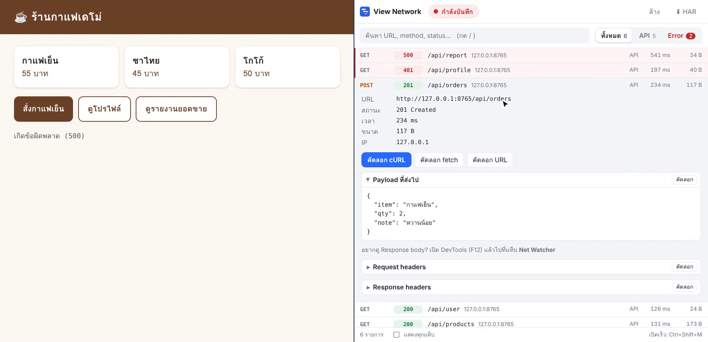

# View Network

Chrome extension สำหรับดู network request ของแท็บที่เปิดอยู่แบบ live — เห็น error ได้ในคลิกเดียว คัดลอกเป็น cURL / fetch และ export เป็นไฟล์ HAR



🎬 **[ดูวิดีโอสาธิตการใช้งาน (51 วินาที, มีเสียง)](docs/demo.mp4)**

## ใช้งานยังไง

1. กดไอคอน View Network บนแถบเครื่องมือ หรือกด **Ctrl+Shift+M** (Mac: **⌘+Shift+M**)
2. รายการ request ของแท็บนี้จะขึ้นมาทันที และอัปเดตเองเมื่อมี request ใหม่
3. กด **Error** เพื่อดูเฉพาะ request ที่พัง (4xx, 5xx, โหลดไม่สำเร็จ) ซึ่งจะเป็นแถบสีแดง
4. กดที่แถวไหนก็ได้ เพื่อดูรายละเอียด, Payload ที่ส่งไป และ headers
5. กด **คัดลอก cURL** แล้วไปวางใน Terminal เพื่อยิง request เดิมซ้ำ

| ปุ่ม | ทำอะไร |
| --- | --- |
| ● กำลังบันทึก | กดเพื่อหยุดชั่วคราว / บันทึกต่อ |
| ทั้งหมด · API · Error | ตัวกรองแบบคลิกเดียว พร้อมจำนวนในแต่ละกลุ่ม |
| ช่องค้นหา | ค้นได้ทั้ง URL, method และ status เช่น `orders 500` (กด `/` เพื่อเริ่มพิมพ์, `Esc` เพื่อล้าง) |
| ล้าง | ล้างรายการของแท็บนี้ |
| ⬇ HAR | ดาวน์โหลดเป็นไฟล์ `.har` ที่เปิดต่อได้ใน Chrome DevTools, Postman, Charles |
| แสดงทุกแท็บ | ดู request จากทุกแท็บรวมกัน |

**อยากดู Response body?** เปิด DevTools (F12) แล้วไปที่แท็บ **Net Watcher** ซึ่งเป็นหน้าเดียวกันแต่แสดง response body ได้ด้วย (Chrome อนุญาตให้อ่าน response body ได้เฉพาะจากใน DevTools เท่านั้น)

## ติดตั้ง

1. ดาวน์โหลดโค้ด
   ```bash
   git clone https://github.com/Lock-Lee/chrome-extention-view-network.git
   ```
2. เปิด `chrome://extensions/` แล้วเปิด **Developer mode** ที่มุมขวาบน
3. กด **Load unpacked** แล้วเลือกโฟลเดอร์ที่มีไฟล์ `manifest.json`
4. กดไอคอนตัวต่อ 🧩 บนแถบเครื่องมือ แล้ว pin **View Network** ไว้

**อัปเดตเวอร์ชัน:** `git pull` แล้วกดปุ่มรีโหลด ↻ ที่การ์ดของ extension ใน `chrome://extensions/`

## ความเป็นส่วนตัว

Extension นี้อ่าน URL, headers และ request body ของทุกเว็บที่เปิด (รวมถึง cookie และ token) ข้อมูลทั้งหมด**อยู่ในเครื่องเท่านั้น**: เก็บใน `chrome.storage.session` ซึ่งจะถูกลบเมื่อปิด Chrome และไม่มีการส่งออกไปที่ไหน

ระวังเมื่อแชร์ไฟล์ HAR หรือคำสั่ง cURL เพราะอาจมี token หรือ cookie ติดไปด้วย

## สำหรับนักพัฒนา

```
background.js   ดักจับ request ด้วย chrome.webRequest และส่งข้อมูลให้ popup แบบ live
ui.js / ui.css  หน้าตา popup และ DevTools panel (ใช้โค้ดชุดเดียวกัน)
lib.js          ฟังก์ชันที่ไม่ผูกกับ browser: cURL, fetch, HAR, ตัวกรอง (มี unit test)
popup.html      หน้าที่เปิดจากไอคอน
panel.html      แท็บ "Net Watcher" ใน DevTools (ใช้ chrome.devtools.network)
```

```bash
npm test        # รัน unit test (Node 18+)
npm run zip     # สร้าง view-network.zip สำหรับอัปโหลดขึ้น Chrome Web Store
```

ข้อจำกัด: ขนาดที่แสดงใน popup อ่านจาก header `Content-Length` จึงอาจแสดง "—" เมื่อเซิร์ฟเวอร์ส่งแบบ chunked ถ้าต้องการขนาดจริงให้ดูในแท็บ Net Watcher

## License

MIT
